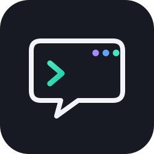

<div align="center">
  
  <h1>gomini</h1>
  <br />
</div>

Gomini is a production-ready, terminal-based AI chat application written in Go. It provides a seamless, keyboard-driven interface for conversing with the Gemini AI, with all chat history and sessions persisted locally using SQLite.

## 💡 Motivation

Ever since I learned Go and SQL/SQLite, I became passionate about mastering them while deepening my experience in backend technologies and database management. To push these skills further, I wanted to combine that data foundation with a Terminal User Interface (TUI) to build a faster, keyboard-driven way to interact with an LLM without constantly switching to a browser.

## 🛠️ Quick Start

### Installation
 ```bash
 go install github.com/Ikit24/gomini/cmd/gomini@latest
 ```

### Usage

 Setup your .env file based on your OS:
 - Linux:
 ```bash
 touch ~/.config/gomini/.env
 ```
 - macOS:
 ```bash
 touch ~/Library/Application\ Support/gomini/.env
 ```
 - Windows:
 ```bash
 echo. > %APPDATA%\gomini\.env
 ```
 - Inside that `.env` file, add your API keys:
 ```env
 GEMINI_API_KEY="your_gemini_key_here"
 OPENAI_API_KEY="your_openai_key_here"
 ```

 Run the application in your terminal. By default, it will use Gemini:
 ```bash
 gomini
 ```
 - To use OpenAI for the session, pass the provider flag:
 ```bash
 gomini --provider=openai
 ```

## 🚀 Features

 - **Terminal User Interface (TUI):** Fully interactive, state-driven command-line interface.
 - **Local Session Management:** Automatically saves and organizes all past chats in a local SQLite database.
 - **Interactive History Browser:** Scroll through past sessions and resume conversations instantly.
 - **Live AI Streaming:** Real-time streaming of LLM responses directly to the terminal viewport.
 - **Different Personas:** Choose from different personas: investing, coding & general use.
 - **File Context Attachment:** You can attach a local file as background context for Gomini when starting the application by using the `--file` flag:
 ```bash
 go run ./cmd/gomini --file path..
 ```
 - **Dynamic Model Switching:** Cycle through Gemini models (`gemini-2.5-flash`, `gemini-2.5-pro`, etc.) on the fly during an active conversation without resetting chat history.

## 📁 Project Structure

The project follows a modular Go layout to separate concerns:
- `cmd/gomini/` - The main application entry point and TUI initialization.
- `internal/database/` - Isolated SQLite connection pool and CRUD operations for sessions and messages.
- `internal/gemini/` - Wrapper client for managing Google AI configurations and stream processing.
- `internal/tui/` - State machine routing, keyboard event handling, and viewport rendering.

## ⌨️ Keyboard Controls

| Context | Key | Action |
| :--- | :--- | :--- |
| **Global** | `ctrl+c` | Quit application |
| **Global** | `ctrl+g` | Show help |
| **Welcome** | `ctrl+n` | Start a new chat |
| **Welcome** | `ctrl+b` | Browse past chat sessions |
| **Browse** | `up` | Move cursor up |
| **Browse** | `down` | Move cursor down |
| **Browse** | `enter` | Load selected chat |
| **Browse** | `esc` | Return to Welcome screen |
| **Chat** | `up` / `pgup` | Scroll chat history up |
| **Chat** | `down` / `pgdn` | Scroll chat history down |
| **Chat** | `ctrl+s` | Submit message |
| **Chat** | `ctrl+b` | Browse past chat sessions |
| **Chat** | `ctrl+n` | Start new chat |
| **Chat** | `ctrl+y` | Copy the latest whole LLM response |
| **Chat** | `alt+y` | Copy the latest code block from LLM response |
| **Chat** | `alt+0` | Switch to general-purpose persona, concise, highly readable answers |
| **Chat** | `alt+1` | Switch to a Socratic coding tutor |
| **Chat** | `alt+2` | Switch to value investor persona by the rules of Benjamin Graham and Warren Buffett |
| **Chat** | `ctrl+t` | Cycle through available LLM models |

## 🛠️ Built with

* [Go](https://go.dev/) - Core language
* [Bubble Tea](https://github.com/charmbracelet/bubbletea) - TUI framework (Elm architecture)
* [Lip Gloss](https://github.com/charmbracelet/lipgloss) - Terminal styling and layout engine
* [Bubbles](https://github.com/charmbracelet/bubbles) - TUI components (viewport, text input, spinner)
* [Google GenAI SDK](https://github.com/google/generative-ai-go) - Gemini API integration
* [OpenAI Go SDK](https://github.com/openai/openai-go) - OpenAI API integration
